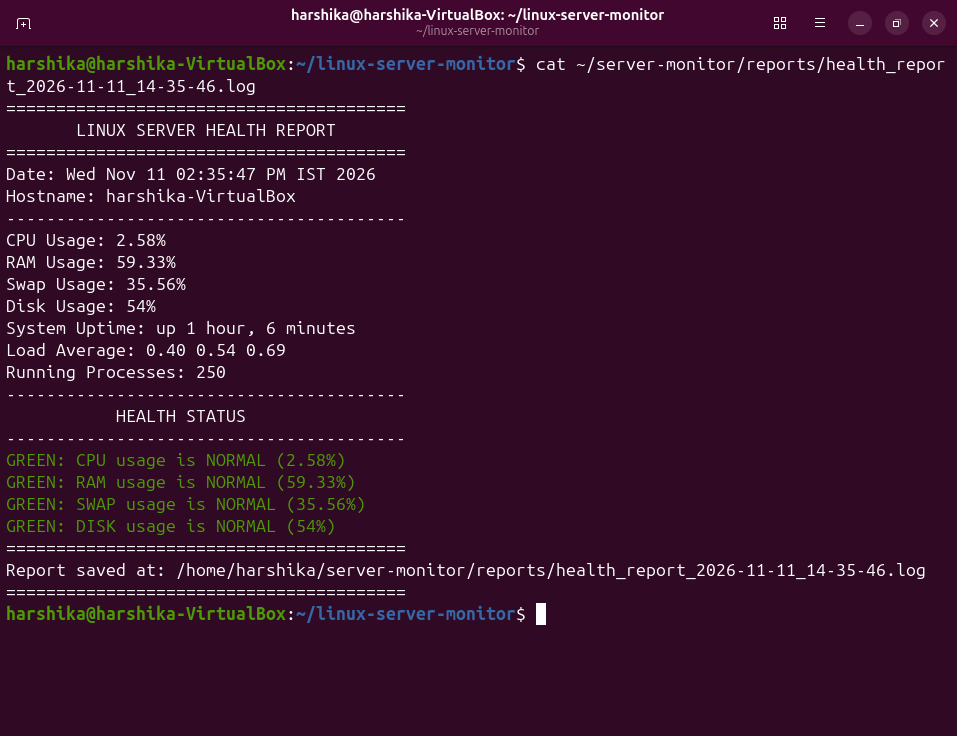
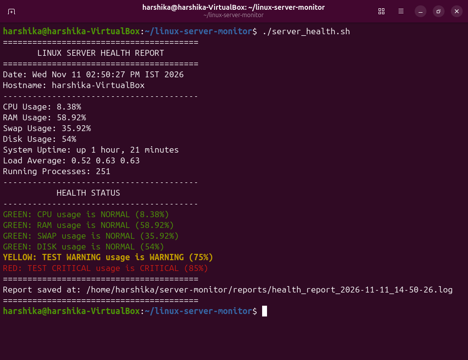
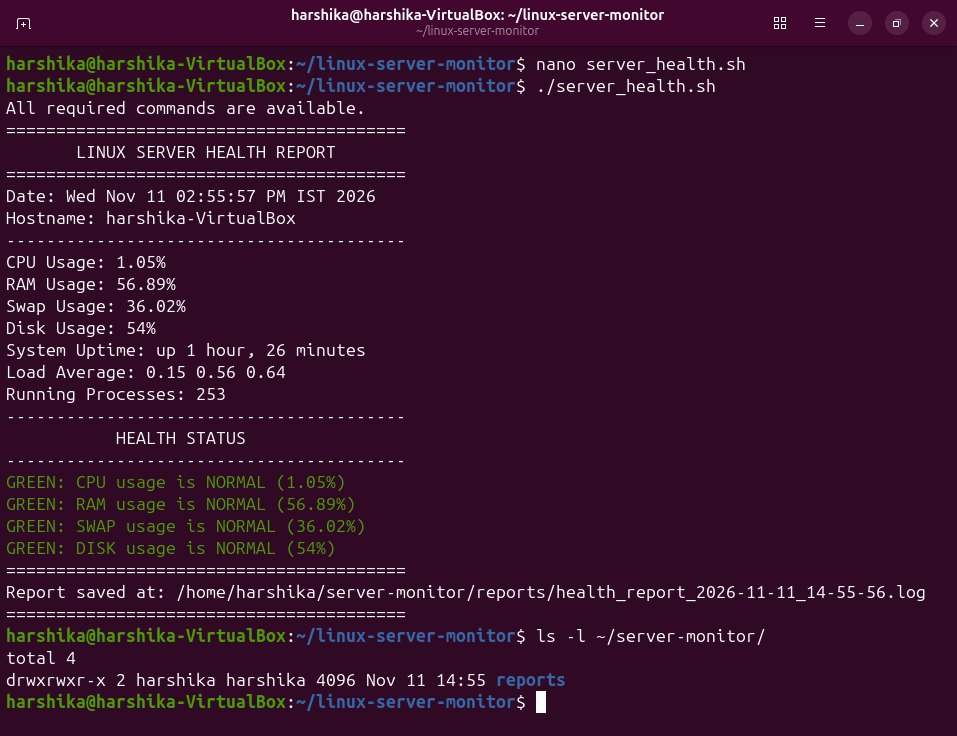
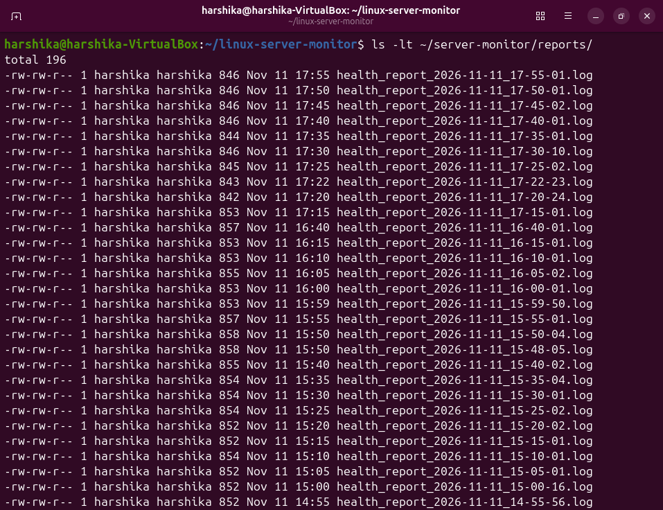

# 🖥️ Dockerized Linux Server Health Monitoring and Automation Tool

A Bash-based Linux server monitoring tool that tracks system resource utilization, generates health reports, identifies resource usage thresholds, and automates monitoring through Cron. The application is also containerized using Docker.

## 🚀 Project Overview

This project automates Linux server health monitoring by collecting system performance metrics and classifying resource utilization into three health levels: GREEN, YELLOW, and RED.

It generates timestamped reports, maintains historical logs, and supports Docker-based execution with persistent report storage.

## ✨ Features

- CPU utilization monitoring
- RAM and swap usage monitoring
- Disk space monitoring
- System uptime and load average
- Running process count
- Threshold-based health alerts:
  - 🟢 GREEN: Normal (<70%)
  - 🟡 YELLOW: Warning (70–79.99%)
  - 🔴 RED: Critical (80% and above)
- Timestamped monitoring reports
- Automatic cleanup of reports older than seven days
- Cron-based scheduled execution
- Error handling for missing dependencies
- Docker image creation and container execution
- Persistent report storage using Docker volumes

## 🛠️ Technology Stack

- Linux (Ubuntu)
- Bash Scripting
- Docker
- Docker Volumes
- Cron
- Git and GitHub
- Linux utilities: `mpstat`, `free`, `df`, `awk`, `ps`

## 📁 Project Structure

```text
linux-server-monitor/
├── Dockerfile
├── server_health.sh
├── README.md
├── docs/
└── screenshots/
```

## ⚙️ Installation and Usage

### 1. Clone the repository

```bash
git clone git@github.com:harshika-sindwani/-Linux-server-health-monitor.git
cd -Linux-server-health-monitor
```

### 2. Make the script executable

```bash
chmod +x server_health.sh
```

### 3. Run the monitoring script

```bash
./server_health.sh
```

## 🐳 Docker Setup

### Build the Docker image

```bash
docker build -t linux-server-monitor:v1 .
```

### Run the container

```bash
docker run --rm linux-server-monitor:v1
```

### Enable persistent report storage

Create a Docker volume:

```bash
docker volume create server-monitor-data
```

Run the container with the volume:

```bash
docker run --rm \
-v server-monitor-data:/root/server-monitor/reports \
linux-server-monitor:v1
```

Reports remain available in the Docker volume even after the container is removed.

## ⏰ Automated Monitoring with Cron

The script can be scheduled to execute every five minutes.

Open the Cron configuration:

```bash
crontab -e
```

Add:

```cron
*/5 * * * * /bin/bash /home/harshika/linux-server-monitor/server_health.sh >/dev/null 2>&1
```

## 📊 Health Thresholds

| Resource usage | Status |
|---|---|
| Below 70% | GREEN – Normal |
| 70% to below 80% | YELLOW – Warning |
| 80% and above | RED – Critical |

## 🔍 Error Handling

The script checks whether required Linux commands are available before execution. If a dependency is missing, it displays an error and records it in a separate error log.

## 📸 Project Screenshots

### 1. Server Health Monitoring


### 2. Threshold-Based Alert Testing


### 3. Dependency Checking and Error Handling


### 4. Automated Monitoring with Cron

The monitoring script is scheduled to execute automatically every five minutes using Linux Cron.



## 🎯 Learning Outcomes

- Linux system administration
- Bash scripting and automation
- Resource monitoring
- Cron scheduling
- Log management and rotation
- Docker image creation and containerization
- Persistent storage using Docker volumes
- Git and GitHub version control

## 👩‍💻 Author

**Harshika Sindwani**

MCA Student | Aspiring DevOps Engineer
